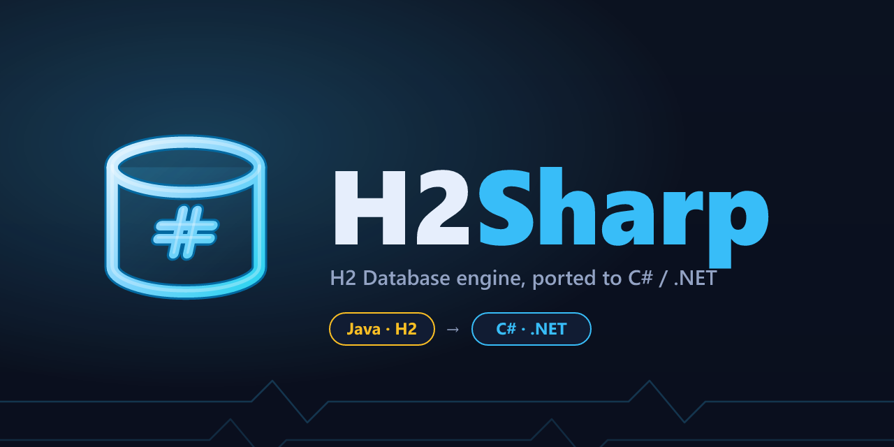

<p align="center">
  
</p>

<p align="center">
  <a href="https://github.com/dimzon/h2sharp/actions/workflows/ci.yml"></a>
  
  
  <a href="LICENSE-H2.txt"></a>
  
  
</p>

**H2Sharp** is an embeddable SQL database engine for .NET — a faithful, actively developed port
of [H2 Database](https://github.com/h2database/h2database) **2.5.x** from Java to C#. It exposes
a standard **ADO.NET** provider (`System.Data.Common`), so ordinary `DbConnection`/`DbCommand`
code, Dapper and provider-agnostic consumers run against an in-process engine: no server, no
separate process. Both in-memory and **file-based MVStore** databases are supported, and files
written here open in the reference Java H2 2.5.259 — and vice versa.

> [!IMPORTANT]
> **Open connections through `H2DataSource`.** It owns the database and is the only correct
> way to connect: every connection it hands out shares one engine instance. A directly
> constructed `H2Connection` is a self-contained, single-connection database and does **not**
> share state — see [Quick start](#quick-start).
>
> The port is in active development with roughly **92% line coverage** and growing. Where the
> reference H2 can do something the port cannot yet, the port throws `TODOException` rather than
> returning a plausible but wrong answer: a stub that refuses is never a stub that answers.

## At a glance

| | |
|---|---|
| **Reference** | H2 **2.5.x**, pinned in [`reference/H2_COMMIT.txt`](reference/H2_COMMIT.txt). Never target another version: 1.x and 2.5.x diverge. |
| **Target frameworks** | `net8.0`, `net10.0` (SDK pinned in [`global.json`](global.json)) |
| **Public API** | `H2Sharp.Data` — **`H2DataSource`** / `H2DataSourceBuilder` (entry point), `H2Connection`, `H2Command`, `H2Parameter`, `H2DataReader`, `H2ProviderFactory`, … |
| **Storage** | in-memory **and** file-based MVStore; files round-trip with reference Java H2 2.5.259 |
| **Status** | active port · ≈92% line coverage and growing · CI on Windows + Ubuntu |
| **License** | `MPL-2.0 OR EPL-1.0` (same terms as H2) |

## Contents

[Quick start](#quick-start) · [Goals](#goals) · [Non-goals](#non-goals) ·
[Project status](#project-status) · [Related projects](#related-projects) ·
[Building and testing](#building-and-testing) · [Tools](#tools) ·
[ADO.NET provider guide](#adonet-provider-guide) · [Porting rules](#porting-rules) ·
[Brand assets](#brand-assets) · [Licensing](#licensing)

Full provider documentation (RU, with examples and gotchas):
[docs/ADO_NET_GUIDE.md](docs/ADO_NET_GUIDE.md).

## Quick start

Plain ADO.NET — no external packages:

```csharp
using System;
using H2Sharp.Data;

// H2DataSource owns the database. Always connect through it.
using H2DataSource source = new H2DataSourceBuilder("Data Source=quickstart;Storage=Memory").Build();
using H2Connection connection = (H2Connection)source.CreateConnection();
connection.Open();

using var create = connection.CreateCommand();
create.CommandText = "CREATE TABLE T(ID INT, NAME VARCHAR(20))";
create.ExecuteNonQuery();

using var insert = connection.CreateCommand();
insert.CommandText = "INSERT INTO T VALUES ($id, $name)";
var id = insert.CreateParameter();
id.ParameterName = "$id";
id.Value = 1;
insert.Parameters.Add(id);
var name = insert.CreateParameter();
name.ParameterName = "$name";
name.Value = "bolt";
insert.Parameters.Add(name);
insert.ExecuteNonQuery();

using var query = connection.CreateCommand();
query.CommandText = "SELECT NAME FROM T WHERE ID = $id";
var key = query.CreateParameter();
key.ParameterName = "$id";
key.Value = 1;
query.Parameters.Add(key);
Console.WriteLine(query.ExecuteScalar()); // bolt
```

With [Dapper](https://github.com/DapperLib/Dapper), the same flow is shorter:

```csharp
using Dapper;
using H2Sharp.Data;

using H2DataSource source = new H2DataSourceBuilder("Data Source=quickstart;Storage=Memory").Build();
using var connection = source.CreateConnection();
connection.Open();
connection.Execute("CREATE TABLE T(ID INT, NAME VARCHAR(20))");
connection.Execute("INSERT INTO T VALUES ($id, $name)", new { id = 1, name = "bolt" });
string name = connection.QuerySingle<string>("SELECT NAME FROM T WHERE ID = $id", new { id = 1 });
```

For a **persistent** database, change the connection string — the data source is still the
entry point:

```csharp
using H2DataSource fileSource = new H2DataSourceBuilder("Data Source=./demo-db;Storage=File")
    .Build();
using H2Connection fileConnection = (H2Connection)fileSource.CreateConnection();
fileConnection.Open();
// The resulting MVStore file is readable by the reference Java H2 2.5.259 and vice versa;
// see tests/H2Sharp.Tests/FileDatabaseOracleTests.cs.
```

Named parameters, arrays, JSON and regex semantics are documented in the
[ADO.NET provider guide](#adonet-provider-guide) below.

## Goals

* Embedded, in-memory and file-based relational database engine.
* Public API as a standard **ADO.NET** provider (`System.Data.Common`), so it works with Dapper,
  `System.Data.Common` consumers and EF Core.
* **MVStore** persistence faithful enough that a database file produced by H2Sharp can be
  opened by the reference Java implementation, and vice versa — this round trip is covered by
  `JavaOracleFact` tests (`tests/H2Sharp.Tests/FileDatabaseOracleTests.cs`).

## Non-goals

* Server/TCP mode and the H2 web console.
* Full-text search.
* Encrypted databases.

## Project status

The port covers the SQL surface, the ADO.NET provider (Dapper, `DbBatch`, `DbCommandBuilder`,
`GetSchema`, typed `DbDataReader`) and the MVStore file engine, with **both** in-memory and
file-based storage. File databases survive reopening and round-trip with the reference Java
H2 2.5.259. Line coverage is roughly **92% and growing**; see
[`docs/COVERAGE_ANALYSIS.md`](docs/COVERAGE_ANALYSIS.md) for the measurement method.

Development is active, and remaining gaps are tracked rather than papered over: where the
reference H2 can do something the port cannot yet, the port throws `TODOException` instead of
returning a plausible but wrong answer. A missing feature is unfinished work on the port, not
a property of the database.

Current numbers, per-phase status and working notes live in the repository rather than in this
README, so they can be updated with the code:

| Document | What it holds |
|---|---|
| [`docs/ROADMAP.md`](docs/ROADMAP.md) | Early phase plan — its status section describes an older snapshot (HEAD `627a7d2`); prefer the working notes and tests for the current state |
| [`MIGRATION_STATUS.md`](MIGRATION_STATUS.md) | Working notes on what has been ported and why |
| [`ADO_NET_TESTS.md`](ADO_NET_TESTS.md) | ADO.NET conformance test suites and their state |
| [`docs/ADO_NET_GUIDE.md`](docs/ADO_NET_GUIDE.md) | Full ADO.NET provider guide (RU): API, connection strings, parameters, readers, transactions, batches, extensions, gotchas |
| [`docs/PORTING.md`](docs/PORTING.md) | How the reference checkout and the port relate |
| [`AGENTS.md`](AGENTS.md) | Rules for porting work in this repository |
| [`docs/COVERAGE_ANALYSIS.md`](docs/COVERAGE_ANALYSIS.md) | Coverage measurement setup and results |

## Related projects

* `H2Sharp.EntityFrameworkCore` — an Entity Framework Core provider for this engine, in a
  sibling checkout (`../h2sharp-efcore`, branch `h2-provider`). It is a fork of the
  EFCore.PG provider with PostgreSQL's surface replaced by H2's: the type mappings, the
  migrations SQL generator, the connection and the DDL are H2's, and the SQL it generates is
  checked against the reference engine on the JVM rather than against this port. Integration
  status and the engine features it relies on are tracked in its `docs/DIVERGENCES.md`.

* `H2Sharp.Linq2Db` — a [linq2db](https://github.com/linq2db/linq2db) provider for this
  engine, in a sibling checkout (`../h2sharp-linq2db`). It is written against linq2db's public
  API and against the engine's public API, and it speaks H2: the identifiers are always quoted,
  the types are H2's, the paging is `LIMIT`/`OFFSET`, the functions of H2 are offered as
  `H2SharpSpecificExtensions`, and the catalogue is read from `INFORMATION_SCHEMA` the way
  H2 2.5 keeps it. Integration status and the engine features it relies on are tracked in its
  `docs/DIVERGENCES.md`.

## Building and testing

```sh
dotnet build H2Sharp.sln
dotnet test
```

CI runs the build and tests on Windows and Ubuntu — see
[`.github/workflows/ci.yml`](.github/workflows/ci.yml). Coverage is measured in **Debug**;
Release inlining distorts line numbers. The measurement setup is in
[`docs/COVERAGE_ANALYSIS.md`](docs/COVERAGE_ANALYSIS.md).

## Tools

The repository also contains small client tools over the engine:

* `tools/H2Sharp.Shell` — console SQL client, similar to `sqlite3`. See
  [tools/H2Sharp.Shell/README.md](tools/H2Sharp.Shell/README.md).
* `tools/H2Sharp.PowerShell` — PowerShell module with `Invoke-H2Query`. See
  [tools/H2Sharp.PowerShell/README.md](tools/H2Sharp.PowerShell/README.md).

## ADO.NET provider guide

This section is a quick reference. For the **full guide** — architecture, every connection
string key, parameter rewriting, value mapping, `IH2DataFormat`, transactions, `DbBatch`,
`DbCommandBuilder`, .NET extensions, async limitations and a symptom → cause → fix table —
see [docs/ADO_NET_GUIDE.md](docs/ADO_NET_GUIDE.md) (in Russian, with verified code samples).
Every snippet below assumes a `connection` obtained from an `H2DataSource` as shown in
[Quick start](#quick-start).

### Named parameters

The ADO.NET provider writes a named parameter as `$name`:

```csharp
connection.QuerySingle<int>("SELECT $Id", new { Id = 1 });
```

Names are case-sensitive (`$Id` and `$id` are different parameters), a name used
twice is the same parameter, and a name with no supplied value is an error. The
rewriter turns `$name` into H2's indexed `$N` before the engine parses the
statement.

`@name` is an H2 session variable and `:name` is ordinary H2 syntax (for example
inside `JSON_OBJECT`); neither is a parameter. This is a breaking change from
older H2Sharp versions, which treated `@name` and `:name` as named parameters.
The EF Core and linq2db providers emit `$` placeholders. Dapper 2.1.66 recognizes
`$` in its parameter filtering and list expansion, so `$Id` and `IN $Ids` work.

### Arrays with ADO.NET and Dapper

H2 array columns use `INTEGER ARRAY`, `VARCHAR(20) ARRAY`, or a bounded type such as
`INTEGER ARRAY[10]`. Array parameters accept CLR arrays, lists, and `IEnumerable` values;
enumerables are consumed once per execution. `string` and `byte[]` remain text and binary
parameters. Use jagged arrays for nested SQL arrays.

```csharp
using H2Sharp.Data;
using Dapper;

using H2DataSource source = new H2DataSourceBuilder("Data Source=arrays;Storage=Memory").Build();
using var connection = source.CreateConnection();
connection.Open();
connection.Execute("CREATE TABLE T(ID INT PRIMARY KEY, NUMBERS INTEGER ARRAY)");

var parameters = new Dapper.DynamicParameters();
parameters.Add("id", 1);
parameters.Add("numbers", new List<int> { 10, 20 }, DbType.Object);
connection.Execute("INSERT INTO T VALUES ($id, $numbers)", parameters);
int[] numbers = connection.QuerySingle<int[]>("SELECT NUMBERS FROM T WHERE ID = 1");
```

The example uses `Dapper`, `System.Data`, and `System.Collections.Generic`. Explicit
`DbType.Object` sends one native array parameter. Dapper's ordinary `IN $ids` list expansion
also works.

`DbDataReader.GetValue()` returns typed arrays: `int[]`, `string[]`, `Guid[]`, etc.
Numeric arrays containing NULL elements return nullable arrays such as `int?[]`;
a NULL column returns `DBNull.Value`, and an empty array remains empty. `GetFieldType()`
reports the non-nullable element's array type independently of row contents.
Use `GetFieldValue<int?[]>()` for a consistent explicit type across rows. Reading a NULL
element into `int[]` throws `InvalidCastException`.

For Dapper properties declared as nullable arrays, configure its typed-reader path once:

```csharp
Dapper.SqlMapper.AddTypeMap(typeof(int?[]), DbType.Object, useGetFieldValue: true);
```

This also allows nullable arrays to be sent as one parameter from an anonymous parameter
object. Without this mapping, Dapper's default materializer directly casts `GetValue()`.

### JSON with ADO.NET and Dapper

JSON columns read as UTF-8 `byte[]` through `GetValue()` and `ExecuteScalar()`, with
`GetFieldType()` reporting `byte[]`, as in H2 2.5 JDBC. Passing those bytes back as a
parameter preserves the JSON document. SQL NULL reads as `DBNull.Value`; JSON `null`
is the four-byte document `null`.

Use `GetString()`, `GetFieldValue<string>()`, or `GetTextReader()` for JSON text.
`GetBytes()`, `GetFieldValue<byte[]>()`, and `GetStream()` expose its UTF-8 bytes.
For ordinary Dapper string mapping, select `CAST(document AS VARCHAR)`.

Parameters accept UTF-8 `byte[]`, `System.Text.Json.JsonDocument`, and
`System.Text.Json.JsonElement` as documents. An ordinary `string` parameter becomes
a JSON **string value**, even when its contents look like an object; this is H2's
conversion rule. STJ values are normalized by the engine when the command runs and
are not disposed by the provider.

```csharp
using var document = System.Text.Json.JsonDocument.Parse("{\"a\": 1}");
var parameters = new Dapper.DynamicParameters();
parameters.Add("document", document, System.Data.DbType.Object);
connection.Execute("INSERT INTO J(D) VALUES ($document)", parameters);
byte[] json = connection.QuerySingle<byte[]>("SELECT D FROM J");
```

With Dapper, pass STJ values explicitly as `DbType.Object`. A future per-connection
choice of JSON representation is tracked in [#29](https://github.com/dimzon/h2sharp/issues/29).

### Regular expressions

`REGEXP`, `~`, `~*`, `!~`, and `!~*` use **.NET regular-expression syntax** and
`System.Text.RegularExpressions`. This is a deliberate project decision. SQL operator
syntax and precedence follow H2 2.5; patterns are not translated from Java syntax.

`~` searches for a match, `~*` ignores case, and `!~` / `!~*` negate the match.
Inline options such as `(?m)`, `(?s)`, and `(?x)` are supported. NULL operands produce
NULL; an invalid pattern raises H2 error `22025`.

```sql
SELECT 'abc' ~ '^a', 'ABC' ~* '^a';
SELECT ID FROM TOPICS WHERE TITLE ~* '(?m)^release' ORDER BY ID;
```

## Porting rules

This is a **port**, not a reimplementation. The reference is H2 2.5 in `reference/h2`, pinned
by `reference/H2_COMMIT.txt`; when the reference and the port disagree, the reference is right
and the difference is work to do. New classes, members or data structures with no counterpart
in `org.h2` are not introduced; where the platform prevents a literal port, a `TODOException`
names exactly what is missing instead of inventing a substitute.

Before contributing, read the house rules and the accepted .NET-only boundary:

* [`AGENTS.md`](AGENTS.md) — the porting rules and the self-check before a commit
* [`docs/PORTING.md`](docs/PORTING.md) — reference checkout, licence headers, workflow
* [`docs/REGRESSION_TEST_PROTOCOL.md`](docs/REGRESSION_TEST_PROTOCOL.md) — `JavaOracleFact` checks against the JVM
* [`docs/ADR_DOTNET_EXTENSIONS.md`](docs/ADR_DOTNET_EXTENSIONS.md) — approved .NET extension points (ADR-001)
* [`docs/APPROVED_DEVIATIONS.md`](docs/APPROVED_DEVIATIONS.md) — approved deviations
* [`docs/VERSIONING.md`](docs/VERSIONING.md) — version lines and tags

## Brand assets

Vector-first assets for READMEs, docs and package icons live in [`assets/`](assets/):

| File | Use |
|---|---|
| `h2sharp-banner-clean.png` / `.svg` | Dark hero banner (no volatile counters) |
| `h2sharp-banner-light-clean.png` / `.svg` | Light hero banner |
| `h2sharp-icon-512.png` | Square package / app icon |
| `h2sharp-logo.svg` / `h2sharp-logo-dark.svg` | Wordmark for light / dark backgrounds |
| `h2sharp-mark.svg` | Transparent cylinder + `#` mark, no tile or frame |

The mark is a **database cylinder** (the H2 identity) with a **`#` hash** (Sharp / C#) drawn
inside it, with a contour around each line and a light gradient within. The banner and icon
shipped in the NuGet package are listed in `src/H2Sharp/H2Sharp.csproj`.

## Licensing

H2 is dual-licensed under the Mozilla Public License 2.0 and the Eclipse Public License 1.0.
H2Sharp is a derivative work and is offered under the same terms; see
[LICENSE-H2.txt](LICENSE-H2.txt), [NOTICE.md](NOTICE.md) and [docs/PORTING.md](docs/PORTING.md).
