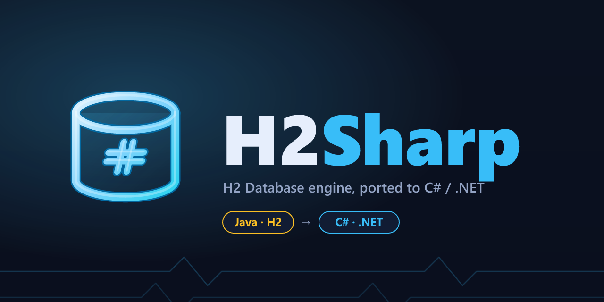

[](https://github.com/dimzon/h2sharp/actions/workflows/ci.yml)


# H2Sharp

H2Sharp is an embeddable SQL database engine for .NET — a faithful port of
[H2 Database](https://github.com/h2database/h2database) **2.5.x** from Java to C#. It exposes a
standard **ADO.NET** provider (`System.Data.Common`), so ordinary `DbConnection`/`DbCommand`
code, Dapper and other provider-agnostic consumers run against an in-process engine: no server,
no separate process. Both in-memory and file-based MVStore databases are supported, and files
written here open in the reference Java H2 2.5.259 — and vice versa.

**Open connections through `H2DataSource`.** It owns the database and is the only correct way to
connect: every connection it hands out shares one engine instance. A directly constructed
`H2Connection` is a self-contained, single-connection database and does **not** share state.

Where the reference H2 can do something the port cannot yet, the port throws `TODOException`
rather than returning a plausible but wrong answer: a stub that refuses is never a stub that
answers.

## Quick start

```csharp
using System;
using H2Sharp.Data;

// H2DataSource owns the database. Always connect through it.
using H2DataSource source = new H2DataSourceBuilder("Data Source=quickstart;Storage=Memory").Build();
using H2Connection connection = (H2Connection)source.CreateConnection();
connection.Open();

using var create = connection.CreateCommand();
create.CommandText = "CREATE TABLE T(ID INT, NAME VARCHAR(20))";
create.ExecuteNonQuery();

using var insert = connection.CreateCommand();
insert.CommandText = "INSERT INTO T VALUES ($id, $name)";
var id = insert.CreateParameter();
id.ParameterName = "$id";
id.Value = 1;
insert.Parameters.Add(id);
var name = insert.CreateParameter();
name.ParameterName = "$name";
name.Value = "bolt";
insert.Parameters.Add(name);
insert.ExecuteNonQuery();

using var query = connection.CreateCommand();
query.CommandText = "SELECT NAME FROM T WHERE ID = $id";
var key = query.CreateParameter();
key.ParameterName = "$id";
key.Value = 1;
query.Parameters.Add(key);
Console.WriteLine(query.ExecuteScalar()); // bolt
```

For a persistent database, change `Storage=Memory` to `Storage=File`. The resulting MVStore
file is readable by the reference Java H2 2.5.259 and vice versa.

## What is in the package

- `H2Sharp.Data` — `H2DataSource`, `H2DataSourceBuilder`, `H2Connection`, `H2Command`,
  `H2Parameter`, `H2DataReader`, `H2ProviderFactory`, `H2Batch` and the ADO.NET provider.
- In-memory and file-based storage; MVStore files round-trip with Java H2 2.5.259.
- Named parameters (`$name`), arrays, JSON, regular expressions with .NET syntax, window
  functions, `INFORMATION_SCHEMA` and MVStore transactions.
- Targets `net8.0` and `net10.0`.

Optional packages are published separately: `H2Sharp.Crypto`, `H2Sharp.Extensions`,
`H2Sharp.CsvTools`, `H2Sharp.Hashes`, `H2Sharp.JavaLegacy`.

## Documentation and source

- [Repository](https://github.com/dimzon/h2sharp)
- [Full provider guide](https://github.com/dimzon/h2sharp/blob/main/docs/ADO_NET_GUIDE.md)
- [Porting rules](https://github.com/dimzon/h2sharp/blob/main/docs/PORTING.md)
- [Migration status](https://github.com/dimzon/h2sharp/blob/main/MIGRATION_STATUS.md)

## Licensing

H2 is dual-licensed under the Mozilla Public License 2.0 and the Eclipse Public License 1.0.
H2Sharp is a derivative work and is offered under the same terms.
